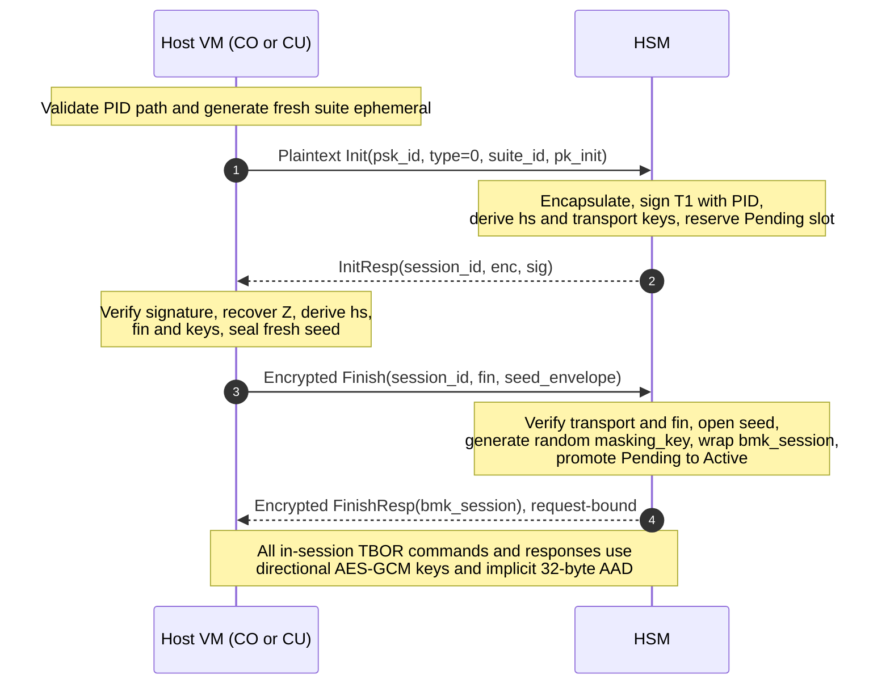

<!--
Copyright (c) Microsoft Corporation.
Licensed under the MIT License.
-->

# TBOR DDI Commands

Per-command specifications for the TBOR DDI protocol.

For the implemented trust model, complete handshake flows, exact key schedule,
transport binding, and security limitations, see
[Tessera Secure Session Implementation](./session-design.md).

Per-command documents in [`commands/`](./commands/) describe only the
request and response **bodies** (the TOC entries that follow the
shared headers below).  Wire framing, TOC entry layout, alignment, and
schema features are defined in the
[TBOR encoding specification](../../fw/core/ddi/tbor/docs/spec.md).

Every command with a defined wire schema is listed.  Commands whose
firmware handler has not yet landed are marked **schema-only** in the
table below (and in their per-command document); they are not yet
dispatchable.

## Request header

Every TBOR DDI request begins with a 12-byte header followed by the
request body's TOC entries and optional variable-length data section.

| Offset | Size | Field | Description |
|---|---|---|---|
| 0 | 2 B | `api_major` | Selected API major revision, little-endian. |
| 2 | 2 B | `api_minor` | Selected API minor revision, little-endian. |
| 4 | 1 B | `toc_count` | Bits 4-0: number of TOC entries minus 1 (`0` = 1 entry, `0x1F` = 32 entries). Bits 7-5 reserved, MUST be `0`. |
| 5 | 1 B | `opcode` | Command identifier; see the [command table](#commands) below. |
| 6 | 2 B | `reserved` | Reserved, MUST be zero. |
| 8 | 4 B | `reserved` | Reserved, MUST be zero. |

The API revision defines both the encoding and command semantics; there is no
separate encoding-version byte. Firmware rejects unsupported revisions. Discovery
reports capabilities, not a cryptographic version negotiation. Session Init binds
the header's revision into its signed transcript and derived keys without
duplicating it in the body. Finish and subsequent session commands must use that
same revision.

## Response header

Every TBOR DDI response begins with a 12-byte header. `status` carries
the `HsmError` value for the request — `0x00000000` on success, a
non-zero `HsmError` variant on failure.  Error responses contain a
single `none` TOC placeholder and no typed body fields.

| Offset | Size | Field | Description |
|---|---|---|---|
| 0 | 2 B | `api_major` | Little-endian; MUST match the request, including in error responses. |
| 2 | 2 B | `api_minor` | Little-endian; MUST match the request, including in error responses. |
| 4 | 1 B | `toc_count` | Bits 4-0: number of TOC entries minus 1. Bits 7-5 reserved, MUST be `0`. |
| 5 | 1 B | `flags` | Bit 0: `FIPS_APPROVED` — set if the operation used only FIPS-approved algorithms. Bits 1-7 reserved, MUST be `0`. |
| 6 | 2 B | `reserved` | Reserved, MUST be zero. |
| 8 | 4 B | `status` | Little-endian `HsmError` value. `0x00000000` = success. |

## Crypto operand byte order

Header and framing integers (`U16`/`U32`/`U64` fields, descriptors) are
always little-endian. Crypto operands — ECC coordinates and signature
components, digests passed to `EccSign` / `EccVerify`, RSA moduli, exponents and
`RsaModExp` / OAEP integers — are carried in the **device byte order**, the
native order of the device's crypto engine, so firmware never copies an
operand just to convert it:

| API revision | Device | Order | P-521 coordinate |
| --- | --- | --- | --- |
| 1.x | Uno (and std Uno) | little-endian | 68 B (66 B value + 2 zero pad bytes above it) |
| 2.0 | Duo (and std Duo) | big-endian | 72 B (66 B value + 6 zero pad bytes after it) |

P-256 / P-384 coordinates are 32 / 48 B in both orders. The host derives
the order from the selected API revision and converts at the DDI
boundary. `PartInfo.pid_pub_key` is the exception: it is big-endian on
every device.

For [`RsaEncryptDecrypt`](./commands/rsa_encrypt_decrypt.md), this applies to
the RSA ciphertext only. Plaintext and OAEP labels are opaque byte strings
and are never reversed.

## Certificate-chain algorithms

Firmware verifies ECDSA (any combination of P-256/P-384/P-521 and SHA-256/384/512),
RSA-2048/3072/4096 (PKCS#1 v1.5 or PSS with SHA-256/384/512), and pure
ML-DSA-44/65/87 certificate signatures. PSS requires MGF1 with the same
digest, trailer field 1, and the declared salt length; RSA public exponents
must fit the PAL's four-byte field. ML-DSA uses an empty context and absent
AlgorithmIdentifier parameters. Composite and HashML-DSA signatures are
not accepted.

On physical Uno, the FP core reads a pure ML-DSA verification message in
place from its IO DMA buffer, by address, and computes the message
representative itself; nothing is copied to the mailbox and the 586-byte
signing limit does not apply. The driver does not return, even when
cancelled or timed out, until the core has answered or recorded a crash, so
the buffer is never reclaimed while the core may still read it.

When present, ML-DSA KeyUsage must contain at least one of digitalSignature,
nonRepudiation/contentCommitment, keyCertSign, or cRLSign, and no other bits
(RFC 9881 section 5). CA certificates still require keyCertSign when
KeyUsage is present. Malformed or duplicate KeyUsage extensions are rejected.

EC KeyUsage forbids keyEncipherment and dataEncipherment; encipherOnly and
decipherOnly require keyAgreement (RFC 5480 and RFC 8813). EC and RSA-PSS-only
end-entity keys cannot assert CA-only usages. RSA-PSS-only KeyUsage permits
signature uses only (RFC 4055); ordinary rsaEncryption keys retain their
encryption capabilities.

Chains may mix issuer algorithms. Existing policy trust anchors and
PTA/PID, attestation-report, and sealing-key profiles remain P-384; allowing
other issuer algorithms does not change those leaf-key requirements.
Signature, issuer/subject, AKID/SKID, CA, KeyUsage, path-length, and critical
extension checks still apply.

Each certificate is limited to 8,192 DER bytes. The walker receives adjacent
certificates into disjoint views of one DMA allocation, sized to the largest
adjacent pair. Parsing and verification borrow the DER without copying
issuer bytes. Metadata uses scoped CPU scratch, and crypto scratch is
reclaimed after each certificate. The IO DMA heap is not enlarged; chains
whose adjacent pair and scratch exceed its available space are rejected.

## Pairwise consistency tests

The std Uno, std Duo, and physical Uno PALs honor selected key-generation
PCTs: sign/verify for ECC and ML-DSA, two-way agreement for ECDH, RSA
sign/verify or encrypt/decrypt, and ML-KEM encapsulate/decapsulate. RSA
generation is supported only by the std PALs. Query
mode performs no generation, entropy draw, or PCT; `None` explicitly skips
the test. TBOR ML key generation requests its PCT before masking or returning
the generated key.

An inconsistent generated key enters physical Uno's FIPS error state.
The simulator returns the matching PCT error without publishing the key.
ML-DSA and ML-KEM failures use `PctValidationMlDsaGenKeyFailed`
(`0x087000ED`) and `PctValidationMlKemGenKeyFailed` (`0x087000EE`).
Partition identity, establish-credential, and session-encryption failures
retain their distinct statuses. An operation that cannot complete a PCT
returns its operation error rather than treating it as a consistency failure.

Restoring the partition unwrapping key explicitly requests
`HsmVaultPct::UnwrappingKey`, an RSA-2048 encrypt/decrypt PCT before vault
storage. The simulator also tests its lazily generated unwrapping key.
Imported ECC/RSA keys retain their component-validation checks and selected
PCTs, with import-specific errors rather than generated-key error-state
handling. PCT secret scratch is zeroized or owned by scrubbed IO storage.

## Paired TOC footprint

Each command reserves the larger of its request and response schema TOC
counts (at least one slot) in both the request and successful response.
Unused trailing slots contain `None`. Both data sections start at
`8 + 4 * toc_count`, so replacing
request metadata with response metadata does not move the payload.

Host and firmware must be updated together. Equal metadata footprints are
the framing prerequisite for shared-buffer execution; handlers still need
to preserve live inputs and validate output capacity before reusing data.
Error responses retain the single `None` placeholder described above.

## Alignment padding

Every masked key (and the `MlDsaSign` signature, written in place over its
masked key) is preceded by a `padding` TOC entry (type 9). The padding
places the field on a 4-byte boundary measured from the start of the
message, so its length is 0..=3 bytes and is usually 0. The entry is
always present, even when its length is 0.

Firmware guarantees only 4-byte alignment for its exchange buffers, so
4-byte message-relative alignment is also 4-byte memory alignment. Both
sides reject:

| Error | Cause |
|---|---|
| `TborMisalignedField` | An aligned field does not start on its 4-byte boundary |
| `TborUnexpectedTocType` | The `padding` entry before an aligned field is missing |

The host decoder reports the same cases on responses as
`DecodeError::MisalignedField` and `DecodeError::UnexpectedTocType`.
Handlers that transform fields in place additionally return
`TborNonCanonicalLayout` when the request fields are not in the layout
the in-place operation requires. See the
[TBOR specification](../../fw/core/ddi/tbor/docs/spec.md) for the framing rules.

## Firmware exchange storage

The IO layer receives the request into a growable DMA allocation, then selects
capacity after parsing the opcode. Growth preserves the address and bytes and
must precede handler scratch allocations. The undo log is allocated separately
and remains valid through outbound DMA, CQE completion, and rollback/commit.
A successful transport completion carrying a TBOR error still rolls back the
command; only command success together with successful CQE posting commits it.

`HsmCmdBuf` exposes the received request, mutable backing storage, and a response
prefix bounded by both allocation and host capacity. Handlers check bounds before
splitting the DMA-branded storage into disjoint live-input/output views.
Native handlers and the custom PAL hook return a response length in that
allocation. Errors overwrite the response prefix in the same storage. Every published byte,
including padding or gaps, must be initialized; overlapping crypto requires an
explicitly supported in-place PAL operation.

All commands encode their compact responses directly into this shared
allocation; there is no legacy dispatch bridge or separately allocated encoded
response. Existing cryptographic working buffers remain scoped independently.
Hash consumes the input before reclaiming it for the digest.
AES places message/IV before the masked key in both host and firmware request
schemas, and transforms those fields in place. ECC signing reuses consumed
envelope metadata for the signature while the key and digest remain disjoint
live inputs. RSA places the input integer before the masked key and uses an
in-place PAL operation to replace that integer with its result while the key
remains disjoint. ML-DSA uses one key/signature buffer with a tail-aligned
expanded key and prefix output; its `μ` input remains disjoint.
ML-KEM reuses a public-key/ciphertext buffer with a separate DMA-branded
shared-secret output. Both consume inputs before overwriting them.
The dispatcher validates the response prefix without modifying unpublished storage.
IO teardown performs final scrubbing after outbound DMA, CQE completion, and the
undo/commit walk, including IO-owned secrets outside the command buffer.
Error-response encoding fully initializes its 12-byte prefix without clearing the
unpublished tail. Scoped scratch is reclaimed without clearing; IO teardown also
scrubs these reclaimed regions using peak allocation ends. Algorithms and encoders
must initialize every byte they consume or publish rather than assume reused
storage is zero.

## Commands

| Opcode | Command | Session | Doc |
|---|---|---|---|
| `0x01` | `ApiRev` | NoSession | [`commands/api_rev.md`](./commands/api_rev.md) |
| `0x02` | `PartInfo` | NoSession | [`commands/part_info.md`](./commands/part_info.md) |
| `0x03` | `SessionOpenInit` | NoSession | [`commands/session_open_init.md`](./commands/session_open_init.md) |
| `0x04` | `SessionOpenFinish` | NoSession | [`commands/session_open_finish.md`](./commands/session_open_finish.md) |
| `0x05` | `SessionClose` | InSession | [`commands/session_close.md`](./commands/session_close.md) |
| `0x06` | `PskChange` | InSession | [`commands/psk_change.md`](./commands/psk_change.md) |
| `0x07` | `PartInit` | InSession | [`commands/part_init.md`](./commands/part_init.md) |
| `0x08` | `PartFinal` | InSession | [`commands/part_final.md`](./commands/part_final.md) |
| `0x09` | `SdSealingKeyGen` | InSession | [`commands/sd_sealing_key_gen.md`](./commands/sd_sealing_key_gen.md) |
| `0x0A` | `SdCreateRemoteBackup` | InSession | [`commands/sd_create_remote_backup.md`](./commands/sd_create_remote_backup.md) |
| `0x0B` | `SdResealRemoteBackup` | InSession | [`commands/sd_reseal_remote_backup.md`](./commands/sd_reseal_remote_backup.md) |
| `0x0C` | `SdRestoreRemoteBackup` | InSession | [`commands/sd_restore_remote_backup.md`](./commands/sd_restore_remote_backup.md) |
| `0x0D` | `SdRestoreLocalBackup` | InSession | [`commands/sd_restore_local_backup.md`](./commands/sd_restore_local_backup.md) |
| `0x0E` | `SdCreatePeerBackup` | InSession | [`commands/sd_create_peer_backup.md`](./commands/sd_create_peer_backup.md) |
| `0x0F` | `SdRestorePeerBackup` | InSession | [`commands/sd_restore_peer_backup.md`](./commands/sd_restore_peer_backup.md) |
| `0x10` | `KeyReport` | InSession | [`commands/key_report.md`](./commands/key_report.md) |
| `0x11` | `HmacGenerateKey` | InSession | [`commands/hmac_generate_key.md`](./commands/hmac_generate_key.md) |
| `0x12` | `Hmac` | InSession | [`commands/hmac.md`](./commands/hmac.md) |
| `0x13` | `GetUnwrappingKey` | InSession | [`commands/get_unwrapping_key.md`](./commands/get_unwrapping_key.md) |
| `0x14` | `UnwrapKey` | InSession | [`commands/unwrap_key.md`](./commands/unwrap_key.md) |
| `0x15` | `AesGenerateKey` | InSession | [`commands/aes_generate_key.md`](./commands/aes_generate_key.md) |
| `0x16` | `AesEncryptDecrypt` | InSession | [`commands/aes_encrypt_decrypt.md`](./commands/aes_encrypt_decrypt.md) |
| `0x17` | `EccGenerateKey` | InSession | [`commands/ecc_generate_key.md`](./commands/ecc_generate_key.md) |
| `0x18` | `EccSign` | InSession | [`commands/ecc_sign.md`](./commands/ecc_sign.md) |
| `0x33` | `EccVerify` | InSession | [`commands/ecc_verify.md`](./commands/ecc_verify.md) |
| `0x19` | `EcdhDerive` | InSession | [`commands/ecdh_derive.md`](./commands/ecdh_derive.md) |
| `0x1A` | `RsaModExp` (raw Decrypt/Sign/Encrypt/Verify) | InSession | [`commands/rsa_mod_exp.md`](./commands/rsa_mod_exp.md) |
| `0x35` | `RsaSign` | InSession | [`commands/rsa_sign.md`](./commands/rsa_sign.md) |
| `0x36` | `RsaVerify` | InSession | [`commands/rsa_verify.md`](./commands/rsa_verify.md) |
| `0x1B` | `Hash` | InSession | [`commands/hash.md`](./commands/hash.md) |
| `0x1C` | `HkdfDerive` | InSession | [`commands/hkdf_derive.md`](./commands/hkdf_derive.md) |
| `0x1D` | `ConcatKdfDerive` | InSession | [`commands/concat_kdf_derive.md`](./commands/concat_kdf_derive.md) |
| `0x1E` | `GetCertChainInfo` | NoSession | [`commands/get_cert_chain_info.md`](./commands/get_cert_chain_info.md) |
| `0x1F` | `GetCertificate` | NoSession | [`commands/get_cert.md`](./commands/get_cert.md) |
| `0x20` | `DarcKexKeyGen` | InSession | [`commands/darc_kex_key_gen.md`](./commands/darc_kex_key_gen.md) |
| `0x21` | `DarcTmkImport` | InSession | [`commands/darc_tmk_import.md`](./commands/darc_tmk_import.md) |
| `0x22` | `DarcKeyUnwrap` | InSession | [`commands/darc_key_unwrap.md`](./commands/darc_key_unwrap.md) |
| `0x23` | `DarcTmkGen` | InSession | [`commands/darc_tmk_gen.md`](./commands/darc_tmk_gen.md) |
| `0x24` | `DarcTmkExport` | InSession | [`commands/darc_tmk_export.md`](./commands/darc_tmk_export.md) |
| `0x25` | `DarcKeyWrap` | InSession | [`commands/darc_key_wrap.md`](./commands/darc_key_wrap.md) |
| `0x26` | `MlDsaGenerateKey` | NoSession | [`commands/mldsa_generate_key.md`](./commands/mldsa_generate_key.md) (**schema-only**) |
| `0x27` | `MlDsaSign` | InSession | [`commands/mldsa_sign.md`](./commands/mldsa_sign.md) |
| `0x28` | `MlDsaVerify` | InSession | [`commands/mldsa_verify.md`](./commands/mldsa_verify.md) |
| `0x29` | `MlKemGenerateKey` | NoSession | [`commands/mlkem_generate_key.md`](./commands/mlkem_generate_key.md) (**schema-only**) |
| `0x2A` | `MlKemEncapsulate` | NoSession | [`commands/mlkem_encapsulate.md`](./commands/mlkem_encapsulate.md) (**schema-only**) |
| `0x2B` | `MlKemDecapsulate` | NoSession | [`commands/mlkem_decapsulate.md`](./commands/mlkem_decapsulate.md) (**schema-only**) |
| `0x2F` | `GetPublicKey` | InSession | [`commands/get_public_key.md`](./commands/get_public_key.md) |
| `0x32` | `VerifyKey` | InSession | [`commands/verify_key.md`](./commands/verify_key.md) |
| `0x34` | `RsaEncryptDecrypt` | InSession | [`commands/rsa_encrypt_decrypt.md`](./commands/rsa_encrypt_decrypt.md) |
| `0x37` | `EcdsaSign` | InSession | [`commands/ecdsa_sign.md`](./commands/ecdsa_sign.md) |
| `0x38` | `EcdsaVerify` | InSession | [`commands/ecdsa_verify.md`](./commands/ecdsa_verify.md) |

`0x33` is assigned to `EccVerify`, `0x35` and `0x36` to `RsaSign` and
`RsaVerify`, and `0x37` and `0x38` to `EcdsaSign` and `EcdsaVerify`.

## Default-PSK gate

Partitions ship with publicly-known compiled-in default PSKs
(`TSRA-DEFAULT-CO-PSK-v1----------` /
`TSRA-DEFAULT-CU-PSK-v1----------`) so they are usable at bring-up.
A session opened against an un-rotated default PSK has no
authentication value and the dispatcher refuses to run any
production work on it.

While the calling session's role still has its **default PSK**, the
only in-session commands permitted are:

| Opcode | Command | Why it's allowed |
|---|---|---|
| `0x05` | `SessionClose` | Tear-down has no security impact |
| `0x06` | `PskChange` | The rotation itself |

Any other in-session opcode returns `DefaultPskMustRotate`
(`0x087000E6`). The gate is **per role**: rotating the CO PSK
does not rotate the CU credential. A successful rotation rebinds its caller to
the new credential and AppId, so that session can continue normal work.
Peer default-authenticated CU sessions receive `DefaultPskChanged`
(`0x087000EF`) except when closing. Out-of-session opcodes (`ApiRev`,
`SessionOpenInit`, `SessionOpenFinish`, `PartInfo`, `GetCertChainInfo`,
`GetCertificate`) remain available. A default-authenticated Pending CU
handshake whose credential changes before Finish is rejected with
`DefaultPskChanged`; a fresh handshake using an obsolete PSK fails
authentication.

**Bootstrap sequence (mandatory on first provisioning):**

1. Open a session for the role under the default PSK.
2. Issue `PskChange` as the first in-session command.
3. Continue normal work on the same session; no close/reopen is required.

The CU PSK is shared across the partition's seven CU slots. Rotation uses
the partition credential transaction lock and a per-session consumed bit.
Exactly one concurrent bootstrap rotation commits. Each session allows one
successful change; further changes return `PskChangeAlreadyUsed`. Failed
attempts do not consume it, and failed completion rolls back the credential,
caller binding and bit together. Reopen preserves the consumed bit.

Migration (NSSR) returns the CO and CU PSKs to their defaults and clears every
slot's consumed bit, as a live-migration target starts with the defaults; it
preserves recovery fingerprints and logical session reservations. Reopen
authenticates with the role's default PSK using fresh channel keys and
restores the original masking key; the reopened session is then held by the
default-PSK gate until it rotates its role PSK again. Explicit plaintext close
is also permitted for `NeedsRenegotiation` only. Migration also clears the
`PartInit` provisioning (policy hash and PTA key), so the host initializes
the partition again. Physical partition disable/free retains its distinct
provisioning reset policy.

The gate is **safe-by-default** in code: future opcodes added to the
dispatcher are gated unless explicitly placed on the
`allowed_with_default_psk` allow-list in
`fw/core/lib/src/ddi/tbor/mod.rs`.

## Session establishment flows

Session establishment is a two-message handshake driven by
[`SessionOpenInit`](./commands/session_open_init.md) and
[`SessionOpenFinish`](./commands/session_open_finish.md). Both CO
(`psk_id = 0`) and CU (`psk_id = 1`) use `session_type = 0`
(`Encrypted`); other type values are rejected. The handshake uses a signed
KEM exchange plus the role PSK, followed by encrypted host confirmation.

The SDK first authenticates the PID certificate path against the caller's
required root SPKI thumbprint and the DICE layer-zero/Tessera-EKU profile. The
[session design](./session-design.md) specifies that validation, the ECDH P-384 suite,
the exact transcript/key schedule, and the distinction between provenance and
persistent unit identity.



### Teardown

The host issues authenticated
[`SessionClose`](./commands/session_close.md); destruction is deferred until
the acknowledgement can be encrypted and completion posted. Flush and
platform teardown provide separate cleanup paths.

Every Init starts a fresh handshake; it has no `bmk_session` resume field.
The emitted masking-key recovery blob is not a resumable channel or a 0-RTT
ticket. See [reset and recovery boundaries](./session-design.md#93-reset-migration-and-recovery-artifacts).

## Duo session transport (API revision 2.0)

Duo devices support API revision 2.0 only and carry TBOR only (no MBOR,
no bulk queue). Every Duo submission is a 128-byte SQE answered by a
64-byte CQE; the SQE opcode (DW0 bits 7-0) selects one of three channels:

| SQE opcode | Name | Carries |
|---|---|---|
| `0` | `Tbor` | Plaintext TBOR: `NoSession` commands and `SessionOpenInit`. |
| `1` | `TborSecure` | TBOR encrypted under the session transport keys: `SessionOpenFinish`, every `InSession` command, and `SessionClose`. |
| `2` | `FlushSession` | No payload. Tears down the session named by the SQE `session_id` (including a Pending one). |

A command sent on the wrong channel is rejected without being executed.
On `TborSecure`, the TBOR body's `session_id` must equal the SQE
`session_id` (DW1).

### Transport keys

`SessionOpenInit` derives an AES-256-GCM key and a 4-byte nonce salt per
direction from the handshake secret `hs` and stores them with the
Pending session, so `SessionOpenFinish` already travels encrypted:

```text
key_h2m ‖ salt_h2m = HKDF-Expand-SHA-384(hs, "tsra-session-xport-h2m-v1" ‖ be16(36), 36)
key_m2h ‖ salt_m2h = HKDF-Expand-SHA-384(hs, "tsra-session-xport-m2h-v1" ‖ be16(36), 36)
```

`key_h2m` protects requests (host → HSM) and `key_m2h` protects responses
(HSM → host); separate keys stop reflection of one direction into the
other. Each message's 96-bit IV is deterministic, so sealing draws no
randomness:

```text
iv = salt_dir(4) ‖ be64(seq_dir)
```

`seq_dir` counts the messages the sender has sealed in that direction,
starting at 0 for the Pending session and continuing after
`SessionOpenFinish` promotes it (the keys are unchanged). Sealing fails
rather than let a counter wrap. On Uno, sessions survive warm and
firmware-update resets while the HSM→VM counter (kept in DTCM) does not,
so its top 16 bits hold a per-partition epoch that every warm boot
advances. An exhausted partition epoch prevents further protected responses;
opening a fresh session alone does not reset that epoch. Recovery must
invalidate obsolete retained key state through the supported platform
lifecycle before restarting it. The receiver uses the IV it is given:
nonce uniqueness is the sender's responsibility. Both CO and CU use these
keys, held by the SDK and the device's session state, rather than a separate
CO outer HMAC envelope.

### Encrypted exchange

1. The host encrypts the entire TBOR request (header, TOC and data)
   in place with `key_h2m` under its next VM→HSM IV, and places the
   IV (DW23–25) and 16-byte tag (DW19–22) in the SQE. `aad_len` (DW26)
   must be `0`: no AAD bytes travel on the wire. Both peers reconstruct
   the implicit 32-byte AAD described below.
2. The HSM decrypts the request and checks the tag before parsing. A tag
   failure, or a session without transport keys, completes with CQE
   status `SESSION_TRANSPORT_ERR` (`0xCC`); session state is unchanged.
3. The TBOR response, success or error, is encrypted with `key_m2h`
   under the next HSM→VM IV; the IV (CQE DW5–7) and tag (CQE DW1–4) are returned
   in the CQE. Response AAD uses the **original request IV**, not the
   response IV. The host retains this expected context per outstanding
   request and authenticates before decoding any response.

Because the SQE `session_id` selects the key, tampering with it fails the
tag check. `SessionClose` defers destroying the session until the CQE has
posted, so its response is still encrypted.

### Implicit request/response AAD (Uno and Duo)

The AAD is exactly 32 bytes, with no wire-format growth:

| Offset | Size | Value |
|---|---|---|
| 0 | 16 | Request: `TSRA-REQ-AAD-V1` followed by NUL; response: `TSRA-RSP-AAD-V1` followed by NUL |
| 16 | 12 | Original request IV |
| 28 | 2 | Session ID, little-endian |
| 30 | 1 | Uno SQE session control (`2` = Close, `3` = InSession); Duo = `0` |
| 31 | 1 | Protocol: `1` = Uno, `2` = Duo |

The request IV uniquely identifies the authenticated encrypted request,
including its TBOR opcode. Each response still uses its sender's independent,
unique HSM→VM encryption IV; it must **never** reuse the request IV as a
response encryption nonce.

On Uno the frame remains `ciphertext ‖ IV(12) ‖ tag(16)`, with plaintext
`message ‖ zero padding ‖ padding-count(1)` padded to 16-byte blocks.
Firmware reserves 32 bytes before receive DMA for the GCM engine's
`AAD ‖ ciphertext` input, then advances the exchange-buffer view past the
AAD without copying the message. Response allocation likewise reserves
local AAD headroom; only the frame is transferred to the host.

Command success/error status is inside the encrypted TBOR response.
Nonzero outer CQE status represents a transport failure and is rejected
without accepting a logical response; arbitrary CQE metadata is not
authenticated by this scheme.

### Out-of-band data

Out-of-band (OOB) items are not encrypted by the transport. On
`TborSecure` they are passed through as on `Tbor`: the SQE OOB fields
(DW2–4) describe the SGL descriptor array, and `oob_len` must equal the
number of items × 16 bytes. Parameters that need confidentiality are
protected at the command level (for example, AEAD-sealed key material).

### Limitations

The host rejects a response from another request, including an old response
to an identical command, while allowing responses to complete out of order.
The local request context is consumed by response authentication.
This does not provide exactly-once execution: firmware does not track received
request IVs, so replaying a request may execute it again. OOB data remains
outside transport authentication.
