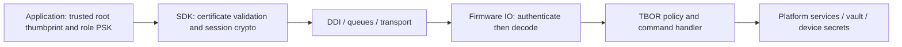
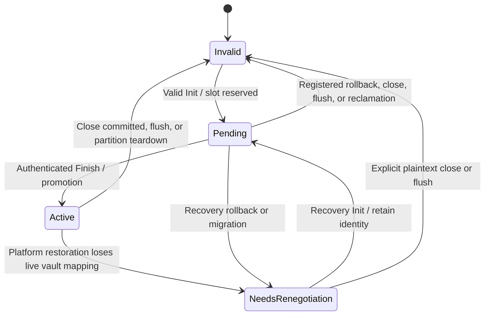
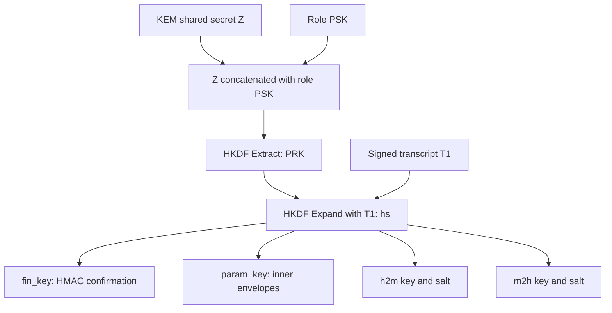
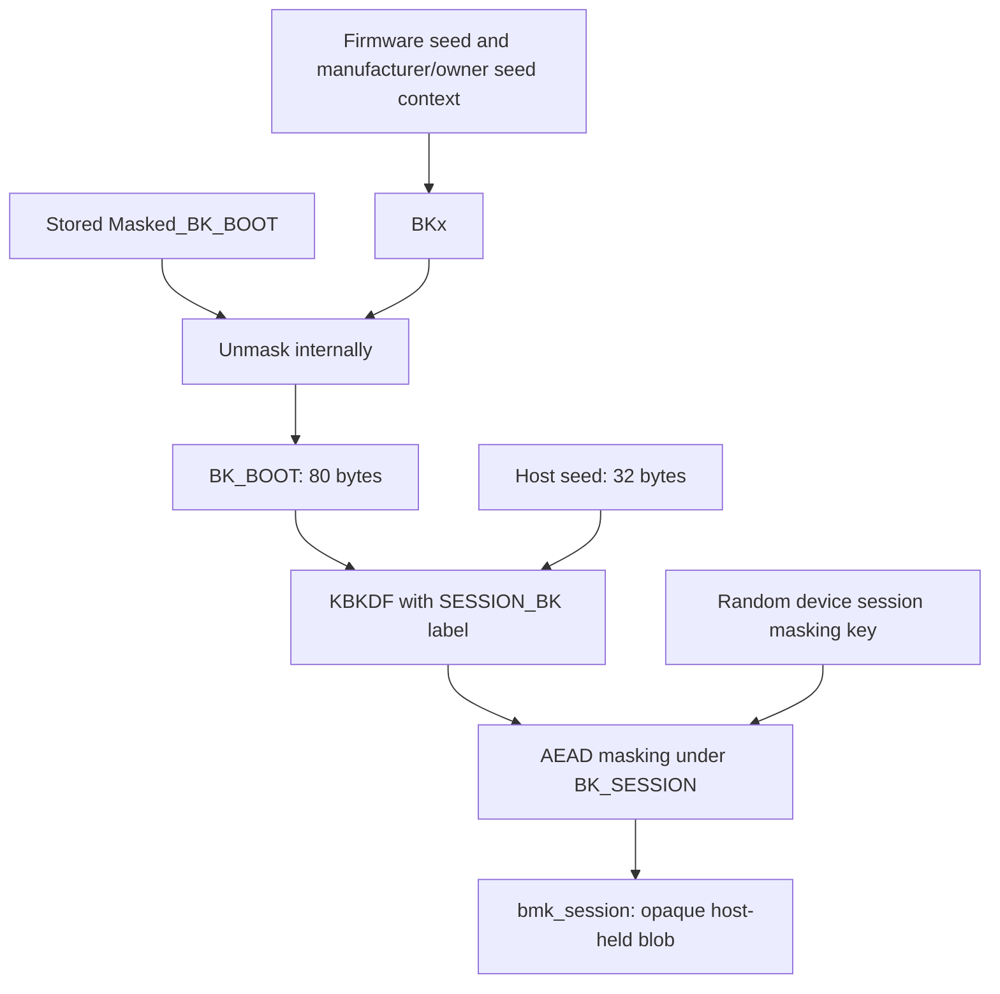
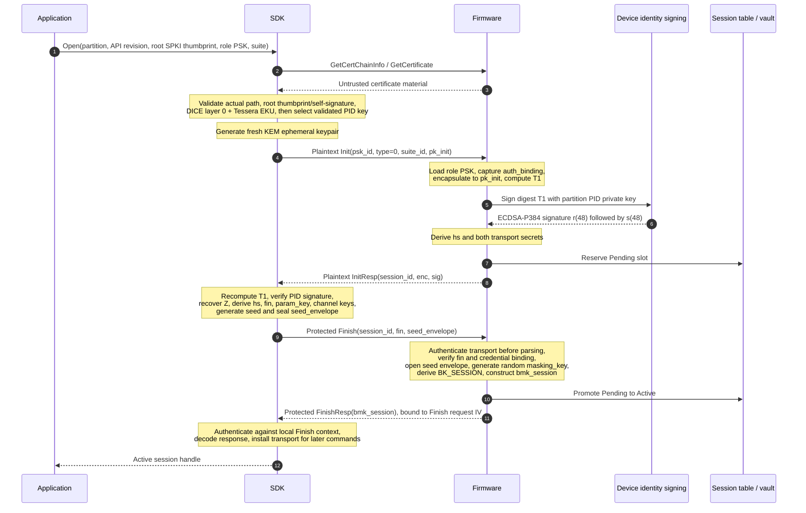
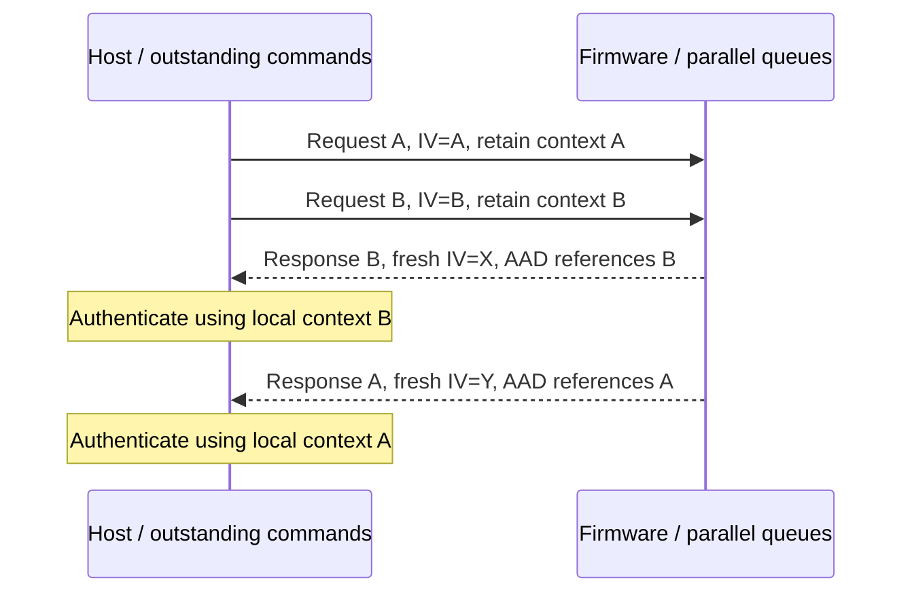
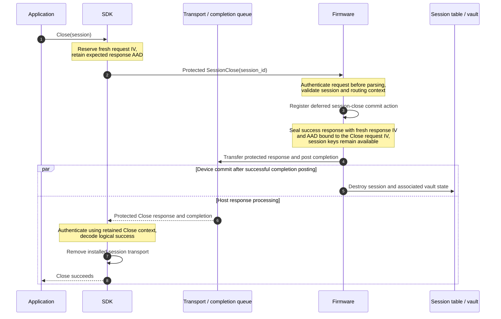

<!--
Copyright (c) Microsoft Corporation.
Licensed under the MIT License.
-->

# Tessera Secure Session Design

## 1. Scope and review context

This document describes the **Tessera secure session protocol** for security
review: establishment, authentication, key derivation, command protection, and
teardown. It specifies the mandatory root SPKI thumbprint and implicit 32-byte
transport AAD, together with the trust assumptions and security boundaries.

The implementation supports secure sessions on Uno and Duo. Uno uses in-band
encryption framing; Duo carries encryption fields in its submission and
completion entries. Both roles use the same encrypted channel. The only
accepted `session_type` is `Encrypted = 0`.

This is a description of the current implementation and its security
arguments, **not an independent security audit, formal proof, or claim that all
possible implementation vulnerabilities have been excluded**.

The session handshake is a Tessera signed KEM-plus-PSK construction. This
document covers its complete key schedule and encrypted channel on both
supported IO protocols.

The sections cover:

- [Architecture and trust](#2-architecture-and-trust-boundaries).
- [Identity and credential provisioning](#3-identity-and-credential-provisioning).
- [Lifecycle and stored state](#4-session-lifecycle-and-stored-state).
- [Cryptographic definitions and key schedule](#5-cryptographic-definitions-and-key-schedule).
- [Establishment flow](#6-session-establishment-flow).
- [Encrypted command transport](#7-encrypted-command-transport).
- [Firmware DMA integration](#8-firmware-dma-integration-and-performance).
- [Rotation, teardown, and recovery](#9-credential-rotation-teardown-and-recovery).
- [Failures and concurrency](#10-failure-and-concurrency-semantics).
- [Security analysis](#11-security-analysis).
- [Deployment and assurance](#12-deployment-and-assurance).

## 2. Architecture and trust boundaries

### 2.1 Participants

| Component | Responsibility |
|---|---|
| Application | Selects the partition, independently trusted root SPKI thumbprint, role credential, and cryptographic suite. Protects credential storage and provisioning policy. |
| Host SDK | Validates the certificate path, runs the host handshake, retains channel keys, seals commands, and authenticates responses before decoding them. |
| DDI backend | Submits commands and returns completions through the selected driver or socket transport. May also enforce local handle/session ownership. |
| Firmware IO layer | Receives DMA, authenticates/decrypts protected requests before TBOR decoding, retains per-request binding, and encrypts replies. |
| TBOR dispatcher and handlers | Check session/channel consistency, role and operation permissions, credential policy, and operation-specific state. |
| Device platform services and vault | Supply cryptography, RNG, protected key storage, partition/session tables, DMA allocation, and completion handling. |



### 2.2 Threat model

The channel is designed to protect its authenticated payloads when an
intermediary can observe, alter, replay, delay, drop, or misroute transport
messages. The application must not accept an HSM identity merely because a
transport endpoint supplied a self-consistent certificate chain.

The argument assumes a trustworthy SDK process, an integrity-protected root
SPKI thumbprint, suitable PSK entropy, correct cryptographic primitives and
RNG, and firmware/platform enforcement of partition and vault isolation.

A compromised SDK process can read its own channel keys and issue commands
with its role's authority. A compromised firmware endpoint or compromised
manufacturer trust hierarchy is outside what this channel can repair.
Transport encryption is not a substitute for host DMA isolation, firmware
integrity, or command authorization.

The protected object is the **encrypted TBOR command or response**, not every
byte in an NVMe exchange. OOB buffers and arbitrary SQE/CQE metadata are not
automatically covered. Sections 7 and 11 make these boundaries explicit.

## 3. Identity and credential provisioning

### 3.1 Independent root trust

Opening an extended session requires:

```text
root_spki_thumbprint =
    SHA-384(DER SubjectPublicKeyInfo of the independently trusted root)
```

The value is exactly 48 bytes. It is a hash of the original DER SPKI, including
its algorithm encoding, **not** a certificate fingerprint or raw EC-coordinate
hash. The thumbprint is public information whose integrity must be protected.

The host requires an independently provisioned thumbprint of exactly 48 bytes.
Missing or incorrectly sized values are rejected. There is no implicit
trust-on-first-use or platform-specific exemption from this requirement.

Before issuing `SessionOpenInit`, the SDK:

1. Fetches the partition identity chain using out-of-session TBOR certificate
   commands.
2. Uses the platform X.509 implementation to validate a path from the PID
   certificate to a root and obtain the **actual verified path**.
3. Hashes that path's root SPKI and compares it with the supplied thumbprint.
4. Explicitly verifies the root certificate's self-signature.
5. Requires one non-PID certificate on that same path to carry both:
   - DICE TCB Info OID `2.23.133.5.4.1`, explicitly declaring `layer = 0`.
   - Tessera device EKU `1.3.6.1.4.1.311.102.1.50.1`.
6. Extracts the handshake verification key from the validated PID certificate.

The DICE `layer` field is context-specific tag `[4]`. An absent layer is not
implicitly layer zero. A qualifying extension on an unused certificate in
the supplied bundle does not satisfy the requirement. The DICE and EKU
requirements must be satisfied by the **same** non-PID certificate.

The root may itself satisfy this profile check. Its explicit self-signature
check matters because an SPKI thumbprint identifies a key, not arbitrary
extensions placed in a certificate containing that key; trust-anchor handling
may otherwise omit checking that signature.

Linux uses OpenSSL's verified chain. Windows copies the verified simple chain
from the certificate-chain context and separately applies the SDK
thumbprint/profile requirements. These checks do not imply a uniform, fresh
online certificate revocation service: revocation behavior depends on the
platform verifier and its configuration/cache.

The std backends issue the following topology:

```text
Root CA
  -> DeviceId CA [DICE layer 0 + Tessera EKU]
    -> Alias CA
      -> Partition Identity (PID)
```

This topology is not a hard-coded SDK chain-length requirement. A physical
device must provide a path satisfying the same trust/profile contract.
Obtaining the expected thumbprint from the same untrusted connection being
authenticated defeats independent enrollment; controlled test enrollment
must not be copied into production provisioning.

### 3.2 Provenance is not persistent unit identity

A successful check authenticates a PID key under the selected Tessera trust
root/profile. It does **not** select one physical unit among all acceptable
units under that root, nor does it provide a fresh measured-boot attestation.
The profile proves the issuer's certificate assertion; the SDK does not
evaluate a firmware-measurement policy in this flow.

PID keys/certificates are partition-lifecycle identities. They can be
regenerated when partition state is recreated; some warm recovery paths
preserve them. A PID thumbprint must not be presented as a guaranteed persistent
device identity. Persistent unit binding is not implemented by this session
API.

### 3.3 Roles and PSKs

| Role | `psk_id` | Logical slots | Channel |
|---|---|---|---|
| Crypto Officer (CO) | `0` | `0` | Encrypted |
| Crypto User (CU) | `1` | `1..=7` | Encrypted |

Sessions are partition-scoped; the numeric slot is not a global identity or
a bearer credential. A slot number can be reused after teardown.

Each role PSK is 32 bytes, conventionally:

```text
PSK = AppId(16) || AppPin(16)
```

`AppId` is public application identity; security must not assume it contributes
secret entropy. Provision a high-entropy secret component. The HKDF schedule
is not a password-stretching scheme or PAKE.

The default CO and CU PSKs are public bootstrap constants. They let a client
establish a channel, but do not distinguish an authorized owner from anyone
else who knows those defaults. The default-PSK dispatcher gate permits only
`PskChange` and `SessionClose` among ordinary in-session commands until the
calling role's credential is rotated. Establishment and discovery remain
available to support bootstrap.

CU bootstrap status belongs to the credential captured at authentication, not
the partition's current default/non-default state. After one session rotates
the partition CU PSK, peer default-authenticated CU sessions become close-only
and receive `DefaultPskChanged` for further work. The rotating caller is rebound
to the new PSK and AppId and remains usable, for both CO and CU.

The application selects the suite explicitly. An unsupported suite or a
nonzero `session_type` is rejected; there is no plaintext-role fallback.

## 4. Session lifecycle and stored state

### 4.1 State machine



`Pending` is **not** a plaintext state. It already contains directional
transport keys so `SessionOpenFinish` and its normal response are encrypted.
It is not an Active session for ordinary key operations.

Session tables are bounded. Implementations manage abandoned Pending slots
and allocation limits according to their table policy; this is not an
unbounded session cache or a guarantee against establishment-resource denial
of service.

### 4.2 Pending handshake state

The logical Pending blob is 243 bytes:

```text
LE16(api_major) || LE16(api_minor)
|| hs(48)
|| T1(48)
|| auth_binding(68)
|| session_type(1)
|| suite_id(1)
|| reopen(1)
|| h2m_secret(36)
|| m2h_secret(36)
```

Each directional secret is `AES key(32) || nonce salt(4)`. Pending state must
make these secrets available to the transport layer before promotion so that
Finish can be authenticated and decrypted.

The software backend holds Pending state in its session table. Physical Uno
stores it in the device vault and maps the logical slot to that protected
object.

### 4.3 Active session state

The committed Active-session vault blob is 216 bytes:

```text
api_revision_tag(8)
|| LE16(api_major) || LE16(api_minor)
|| param_key(32)
|| masking_key(32)
|| auth_binding(68)
|| h2m_secret(36)
|| m2h_secret(36)
```

The 8-byte tag identifies the internal session format; it is distinct from
the following 4-byte selected Uno/Duo DDI revision. Both Pending and Active
state pin the selected revision, and Finish and later commands must match it.
The Active blob does not contain `hs`, `T1`, or the KEM private key.

`auth_binding` snapshots the credential used at establishment:

```text
LE32(role_is_CU) || AppId(16) || SHA-384(PSK)(48)
```

It is internal credential-derived state, not a public authentication token.
The implementation revalidates it in Finish, PSK rotation, KeyReport, and
every ordinary CU command, including bulk work. CU sessions established
with the default credential remain stale after a peer rotates; the caller's
binding is updated atomically with its own rotation. Close remains available.
Rotation does not universally destroy all open sessions
or apply the CU ordinary-command policy to CO sessions.

The vault mapping, rather than only the reusable logical slot number, also
supports ownership/cleanup of session-associated vault objects.

Separate firmware-owned per-slot recovery metadata holds
`SHA-384(masking_key)[0..16]` and one PSK-change-consumed bit. Migration and
partition disable keep the fingerprint but clear the consumed bit, since both
return the PSKs to their defaults. Fresh close/free clears both; recovery does
not reset them. A Pending recovery keeps its renegotiation reservation and
cannot be evicted by a fresh open.

## 5. Cryptographic definitions and key schedule

### 5.1 Notation

| Notation | Meaning |
|---|---|
| `A \|\| B` | Byte concatenation. |
| `BE16(n)`, `BE32(n)`, `BE64(n)` | Unsigned big-endian integer encoding. |
| `LE16(n)`, `LE32(n)` | Unsigned little-endian integer encoding. |
| `H(M)` | SHA-384, 48-byte output. |
| `Extract(salt, IKM)` | HKDF-Extract using HMAC-SHA-384. |
| `Expand(PRK, info, L)` | HKDF-Expand using HMAC-SHA-384, output length `L` bytes. |
| `ExpandLabel(K, label, L)` | Tessera labeled expansion: `Expand(K, ASCII(label) \|\| BE16(L), L)`. |
| `GCM.Seal(K, N, A, P)` | AES-256-GCM with nonce `N`, AAD `A`, and plaintext `P`; returns ciphertext and 16-byte tag. |

Labels are ASCII without an implicit NUL unless explicitly shown. The output
length in `ExpandLabel` is in **bytes**. This encoding is not TLS
`HKDF-Expand-Label`: it has no TLS prefix or TLS encoded label/context record.

### 5.2 Supported suites

| `suite_id` | KEM / key agreement | `pk_init` | `enc` | `Z` | Transcript authentication |
|---|---|---|---|---|---|
| `0x01` | Ephemeral-ephemeral ECDH P-384 | 97-byte SEC1 point | 97-byte device ephemeral SEC1 point | 48-byte big-endian shared x-coordinate | ECDSA P-384 with PID key |

P-384 points are `0x04 || X_be(48) || Y_be(48)`. ECDSA signatures on the wire
are fixed-size `r_be(48) || s_be(48)`, not ASN.1 DER signatures.

ECDH P-384 is the only supported session suite. Other suite identifiers
are rejected with `UnsupportedSessionSuite`.

#### 5.2.1 ECDH P-384 shared-secret derivation

Let `G` be the P-384 base point. The partition identity key signs the
exchange and is independent of the device's ephemeral ECDH key.

For each establishment, the host and device generate independent ephemeral
private scalars `a` and `b`, respectively:

```text
Host:
    a <- fresh valid P-384 private scalar
    A = a * G
    pk_init = SEC1_uncompressed(A)                         # 97 bytes

Device:
    b <- fresh valid P-384 private scalar
    B = b * G
    enc = SEC1_uncompressed(B)                             # 97 bytes
    S_device = b * A
    Z_device = I2OSP(x(S_device), 48)

Host, after verifying the device transcript signature:
    S_host = a * B
    Z_host = I2OSP(x(S_host), 48)
```

`I2OSP(x, 48)` encodes the x-coordinate as exactly 48 big-endian bytes,
including any leading zeros. Because `a * (b * G) = b * (a * G)`, both
peers obtain the same `Z`. In this suite, `enc` is an ephemeral public
point, not an encrypted message.

Security requires the received public points to be valid P-384 points,
not the point at infinity. Invalid public-key encodings or unsuccessful
key-agreement operations must be rejected. The raw shared x-coordinate
enters the HKDF extraction below; there is no additional protocol-level
hash or KEM extraction between this `Z` and `Z || PSK`.

### 5.3 Signed transcript

#### 5.3.1 Exact bytes being signed

Let `pk_pid` be the public key from the validated PID certificate, encoded
as a 97-byte uncompressed P-384 point. Its corresponding private key is
`sk_pid`, held only by the device. Define the transcript byte string `M1`
and its digest:

```text
M1 =
    "TSRA-SESSION-v1"
    || BE16(api_major) || BE16(api_minor)
    || suite_id(1)
    || psk_id(1)
    || session_type(1)
    || pk_pid(97)
    || BE16(len(pk_init)) || pk_init
    || BE16(len(enc))     || enc

T1 = SHA-384(M1)                                           # 48 bytes
```

There is no terminal NUL on `"TSRA-SESSION-v1"`. The selected revision comes
from the common 12-byte TBOR header, not a duplicate Init body field. Its
16-bit components are little-endian on the wire and in session storage but
explicitly big-endian in `M1`. No other header fields, alignment padding,
certificate wrapper, or signature bytes are inserted into `M1`.
With `Lp = len(pk_init)` and `Le = len(enc)`, its layout is:

| Offset | Length | Value |
|---|---|---|
| `0` | 15 | ASCII `TSRA-SESSION-v1`. |
| `15` | 2 | `BE16(api_major)`. |
| `17` | 2 | `BE16(api_minor)`. |
| `19` | 1 | Selected `suite_id`. |
| `20` | 1 | Selected `psk_id`: CO `0`, CU `1`. |
| `21` | 1 | `session_type = 0`. |
| `22` | 97 | Validated PID public key `pk_pid`. |
| `119` | 2 | `BE16(Lp)`. |
| `121` | `Lp` | Host ephemeral public key `pk_init`. |
| `121 + Lp` | 2 | `BE16(Le)`. |
| `123 + Lp` | `Le` | Device encapsulation output `enc`. |

`M1` is 317 bytes for ECDH P-384.
The two-byte lengths encode byte counts, not bit counts.

#### 5.3.2 Device ECDSA signing

The device signs **the already computed 48-byte digest `T1`** with its
partition identity private key. The signing operation does not hash `T1`
again:

```text
sig = ECDSA-P384.SignDigest(sk_pid, T1)
```

`sk_pid` is the device-held partition identity private key. It is not the
ephemeral ECDH private key, the PSK, or a key derived from `hs`.

The signature is encoded as `r(48) || s(48)`, with each component
big-endian and left-padded to 48 bytes: 96 bytes total, not DER. The
device returns it with `enc` and the allocated session ID in the Init
response. The PID certificate chain authenticates the verification key;
the handshake signature separately authenticates the current exchange.

#### 5.3.3 Host verification and authenticated fields

The host must use its validated `pk_pid`, its original `pk_init`, and its
locally selected API revision, suite, role, and type to reconstruct `M1`. It must not
accept an untrusted replacement of those local choices when reconstructing
the transcript. It hashes `M1` once and verifies the returned signature
against that digest.

```text
ECDSA-P384.VerifyDigest(pk_pid, T1, sig) == true
```

Malformed encodings, wrong lengths, or failed verification terminate
establishment. Only after signature verification does the host derive
`Z` from the received `enc` and continue to the PSK-based key schedule.

The signature binds the PID key, host ephemeral public key, device
encapsulation output, API revision, role, encrypted profile, and suite to one transcript.
It does not itself prove that the device used the same PSK as the host.
That agreement is confirmed by the protected Finish exchange.

The allocated `session_id`, complete certificate DER, and queue/PRP fields
are **not** directly included in `T1`. Subsequent
transport AAD and firmware SQE/body consistency checks bind session routing;
the root/profile check authenticates certificate provenance separately.

Binding the selected revision prevents an intermediary from changing it while
preserving a valid handshake signature or matching session keys. Capability
discovery is not an authenticated version negotiation: this binding does not
prove that the host selected the highest revision the device supports.

The PSK and the later host seed are not explicit transcript fields either.
The PSK enters secret extraction, while the seed is authenticated inside
Finish. The fresh host ephemeral key supplies handshake freshness: a
signature from a different host ephemeral exchange will not verify against
the current host's reconstructed `T1`. This does not select a persistent
physical unit or prevent transport relaying to an otherwise acceptable
device.

### 5.4 Handshake and channel keys

```text
IKM = Z || PSK
PRK = Extract("TSRA-SESSION-v1", IKM)                         # 48 bytes
hs  = Expand(PRK, "tsra-session-hs-v1" || T1, 48)            # 48 bytes

fin_key = ExpandLabel(hs, "tsra-session-host-fin-v1", 48)
fin     = HMAC-SHA-384(fin_key, T1)                          # 48 bytes

param_key = ExpandLabel(hs, "tsra-session-param-v1", 32)

h2m_secret = ExpandLabel(hs, "tsra-session-xport-h2m-v1", 36)
m2h_secret = ExpandLabel(hs, "tsra-session-xport-m2h-v1", 36)

K_h2m = h2m_secret[0:32]     salt_h2m = h2m_secret[32:36]
K_m2h = m2h_secret[0:32]     salt_m2h = m2h_secret[32:36]
```

The `hs` expansion is deliberately different from `ExpandLabel`: its `info`
is the label followed by `T1`, with no appended output-length field.



Distinct labels separate confirmation, parameter protection, and the two
transport directions. `sk_pid` authenticates the transcript; it is not the
ECDH ephemeral private key and is not an input secret to this HKDF schedule.

#### 5.4.1 Extraction and transcript-dependent handshake secret

HKDF-Extract uses HMAC with the public ASCII protocol label as its salt:

```text
salt_extract = ASCII("TSRA-SESSION-v1")                     # 15 bytes
IKM = Z || PSK
PRK = HMAC-SHA-384(key = salt_extract, message = IKM)        # 48 bytes
```

The input length is 80 bytes for ECDH (`48 + 32`).
The salt is a domain separator, not secret randomness or the
four-byte transport nonce salt. Freshness comes from the key-establishment
operation. The entire 32-byte role PSK is included, including its public
application-ID portion; only its secret portion contributes secret entropy.

HKDF-Expand appends a one-byte block counter. Because SHA-384 emits
48 bytes and `hs` has length 48, only one expansion block is needed:

```text
info_hs = ASCII("tsra-session-hs-v1") || T1
hs = HMAC-SHA-384(
    key = PRK,
    message = info_hs || 0x01
)                                                         # 48 bytes
```

Thus a different signed transcript changes `hs` even if an input shared
secret or PSK were otherwise the same. The host and device must agree on
`Z`, the PSK, and the exact `T1` bytes to derive matching channel keys.

#### 5.4.2 Labeled child-secret expansion

Each child expansion starts from `hs`, not from another child secret:

```text
info_child = ASCII(label) || BE16(L)
child = first_L_bytes(
    HMAC-SHA-384(key = hs, message = info_child || 0x01)
)
```

All specified child lengths are at most 48 bytes, so each uses a single
HKDF expansion block. The `0x01` byte is the HKDF block counter; it is not
part of the ASCII label. The two-byte length preceding it is in bytes.

| Child | Exact ASCII label | `L` | Encoded length |
|---|---|---|---|
| `fin_key` | `tsra-session-host-fin-v1` | 48 | `00 30` |
| `param_key` | `tsra-session-param-v1` | 32 | `00 20` |
| `h2m_secret` | `tsra-session-xport-h2m-v1` | 36 | `00 24` |
| `m2h_secret` | `tsra-session-xport-m2h-v1` | 36 | `00 24` |

`fin_key` is used only for transcript confirmation. `param_key` protects
sensitive parameter envelopes. The directional transport keys protect
complete command and response bodies. Separating these purposes by label
prevents one key from being used interchangeably across those operations.
In particular, the host-to-device and device-to-host labels are different
even though both produce 36-byte outputs.

The 36-byte directional outputs are split without a further hash or KDF:

```text
K_h2m    = h2m_secret[0:32]
salt_h2m = h2m_secret[32:36]
K_m2h    = m2h_secret[0:32]
salt_m2h = m2h_secret[32:36]

request_IV  = salt_h2m || BE64(request_sender_sequence)
response_IV = salt_m2h || BE64(response_sender_sequence)
```

The four-byte salts are deterministic for the handshake and fixed for the
life of those traffic keys. Per-encryption sender sequences supply nonce
uniqueness; the platform reset rules are in Section 7.1. These salts are
not authentication tags. Each GCM encryption separately produces its own
16-byte authentication tag.

#### 5.4.3 Host confirmation

The host computes the 48-byte Finish confirmation:

```text
fin = HMAC-SHA-384(key = fin_key, message = T1)
```

This is a MAC, not another PID signature and not a hash of the full Finish
message. The enclosing request's GCM authentication covers the complete
Finish command, including the seed envelope and session-bearing fields.
The explicit MAC confirms the signed transcript under a dedicated
handshake-derived confirmation key.

Because confirmation and encryption keys derive from the same `hs`, they
are separated uses of the same authenticated key-establishment result,
not independent authentication factors. A shared role PSK authenticates
membership in that credential group, not an individual person or process.

### 5.5 Seed, masking key, and boot-key hierarchy

Channel keys are known to both peers. The device's session masking key is
different: **the firmware generates it randomly and does not derive it from
`hs`**, because the host also knows `hs`.

```text
seed        = HostRandom(32)
masking_key = DeviceRandom(32)

BK_SESSION = KBKDF-HMAC-SHA-384(
    KDK     = BK_BOOT,
    Label   = "SESSION_BK",
    Context = seed,
    L       = 256 bits
)

bmk_session = AEAD_Mask(
    key       = BK_SESSION,
    plaintext = masking_key,
    AAD       = MaskedKeyMetadata(192)
)
```

The counter-mode KBKDF result is the first 32 bytes of:

```text
HMAC-SHA-384(
    BK_BOOT,
    BE32(1) || "SESSION_BK" || 0x00 || seed || BE32(256)
)
```

`BK_BOOT` is an 80-byte device-controlled key, not a handshake-derived
32-byte AES key. It is generated randomly at partition allocation and retained
in masked form. Its masking key `BKx` is derived from the firmware seed using
label `BK_BOOT_MK_DEFAULT` and manufacturer/owner seed context. Firmware
recovers `BK_BOOT` internally when constructing `bmk_session`.

The `bmk_session` metadata binds the masking-key kind, vault attributes,
manufacturer SVN, owner-seed lineage, and key label `SESSION_BMK`. The current
32-byte masking key plus 192-byte metadata and AEAD framing produces a
264-byte blob. The host treats it as opaque and cannot derive `BK_SESSION`
from the session handshake.



Only the masking key is wrapped in `bmk_session`. It is not a serialized
transport context and does not contain `param_key`, channel keys, sender
counters, or an authorization to resume application traffic without a fresh
handshake.

#### 5.5.1 Device boot wrapping root

The device creates `BK_BOOT` as 80 random bytes at partition allocation.
This is generated key material, not an expansion of the role PSK, host
seed, PID key, or handshake secret.

The device stores only an authenticated, encrypted representation of
`BK_BOOT`. Its protection key `BKx` is derived from device-controlled
seed material using SP 800-108 counter-mode KBKDF with HMAC-SHA-384:

```text
context_boot =
    manufacturer_seed[manufacturer_SVN]
    || owner_seed[owner_seed_id]

D1 = HMAC-SHA-384(
    firmware_seed,
    BE32(1) || "BK_BOOT_MK_DEFAULT" || 0x00
    || context_boot || BE32(640)
)
D2 = HMAC-SHA-384(
    firmware_seed,
    BE32(2) || "BK_BOOT_MK_DEFAULT" || 0x00
    || context_boot || BE32(640)
)
BKx = first_80_bytes(D1 || D2)
```

The output-length field is **640 bits**, yielding 80 bytes from two
48-byte HMAC outputs. Unlike the HKDF child labels, the KBKDF input uses
a four-byte counter, an explicit `0x00` separator, and a four-byte
big-endian output length in bits.

The first 32 bytes of `BKx` supply the AES-256-CBC wrapping key; the
remaining 48 bytes supply the HMAC-SHA-384 key for encrypt-then-MAC
protection of the stored boot-key record. A fresh CBC IV is generated
when the record is created. The authenticated record binds its metadata
and encrypted key material; it must authenticate before recovered
`BK_BOOT` is used.

Reconstructing `BKx` with the selected manufacturer and owner seed
lineage allows the device to recover `BK_BOOT` internally. Neither
`BKx` nor unwrapped `BK_BOOT` is sent to the host. This hierarchy
keeps boot-root protection independent of the host-known channel
schedule.

#### 5.5.2 Session wrapping-key derivation

After authenticating Finish and recovering its 32-byte host seed, the
device derives:

```text
input_session =
    BE32(1) || ASCII("SESSION_BK") || 0x00 || seed || BE32(256)

BK_SESSION = first_32_bytes(
    HMAC-SHA-384(key = BK_BOOT, message = input_session)
)
```

This is the single-block instance of the same KBKDF with a **256-bit**
output. The label is exactly `SESSION_BK`, without a terminating NUL.
The explicit `0x00` between label and seed is the KDF separator.

The seed is a derivation context, not a wrapping key. A fresh seed
normally gives each establishment a distinct wrapping key. Even
knowing or choosing the seed does not allow the host to compute
`BK_SESSION` without the device-only `BK_BOOT`. Repeating a seed
repeats this derived key under the same boot root; wrapping-nonce
uniqueness must therefore hold independently of seed freshness.

#### 5.5.3 Random masking key and authenticated wrapping

The device independently generates the 32-byte `masking_key`. It then
uses AES-256-GCM to wrap it under `BK_SESSION`:

```text
N_bmk = DeviceRandom(12)
AAD_bmk = encoded_masking_metadata                         # 192 bytes

(C_bmk, tag_bmk) = GCM.Seal(
    K = BK_SESSION,
    N = N_bmk,
    A = AAD_bmk,
    P = masking_key
)
```

The metadata is authenticated, not encrypted. It contains:

| Offset | Length | Authenticated value |
|---|---|---|
| `0` | 4 | ASCII `MKEY`. |
| `4` | 2 | Metadata version `LE16(1)`. |
| `6` | 1 | Masking-key kind. |
| `7` | 1 | Key-label length, 11. |
| `8` | 8 | Key usage/attribute bits, little-endian. |
| `16` | 8 | Manufacturer SVN, little-endian. |
| `24` | 2 | Owner-seed lineage ID, little-endian. |
| `26` | 128 | ASCII `SESSION_BMK` followed by zero padding. |
| `154` | 1 | Plaintext padding count, zero for the 32-byte key. |
| `155` | 37 | Reserved zero bytes. |

The resulting blob contains:

```text
bmk_session =
    AEAD_header(8)
    || N_bmk(12) || 0x00000001
    || AAD_bmk(192)
    || C_bmk(32)
    || tag_bmk(16)
    = 264 bytes
```

The four-byte stored IV suffix is framing, not additional nonce entropy.
Every metadata byte and the encrypted masking key are authenticated
by GCM. Any later unwrapping must also apply the relevant lineage and
key-usage policy; authenticating metadata is not the same as deciding
that its values are currently authorized.

The host can retain this opaque blob but cannot recover the masking
key from `hs`, the PSK, `param_key`, the seed, or channel traffic.
This separation is why the masking key is random device-only material
rather than another host-known child of `hs`.

### 5.6 Key inventory

| Material | Size | Holders / lifecycle | Purpose |
|---|---|---|---|
| Root SPKI thumbprint | 48 bytes | Application; provisioned independently | Root-key authentication; integrity-sensitive, not secret. |
| PID private key | P-384 scalar | HSM partition lifecycle | Sign `T1`. |
| Role PSK | 32 bytes | Authorized application and HSM partition | Role credential mixed with `Z`. |
| Initiator ephemeral private key | Suite-dependent | Host handshake only | Recover `Z`. |
| Device ECDH ephemeral private key | P-384 scalar | Device handshake IO | Produce `Z` for suite `0x01`. |
| `Z`, `PRK`, `hs` | 32/48, 48, 48 bytes | Handshake processing / Pending state as applicable | Establish fresh separated keys. |
| `fin_key` | 48 bytes | Handshake processing | Host confirmation. |
| `param_key` | 32 bytes | Host and Active HSM session | Inner parameter envelopes. |
| `K_h2m`, `K_m2h` | 32 bytes each | Host and Pending/Active HSM session | Directional command/response encryption. |
| Directional salts | 4 bytes each | With their channel keys | Prefix deterministic transport nonces. |
| `seed` | 32 bytes | Host Finish construction and HSM Finish processing | Context for `BK_SESSION`; not a device root secret. |
| `BK_BOOT`, `BK_SESSION` | 80, 32 bytes | Device only | Wrap the device-generated masking key. |
| `masking_key` | 32 bytes | Device session; wrapped form available to host | Session-scoped key masking, separate from channel encryption. |

## 6. Session establishment flow

### 6.1 Successful establishment



There are two handshake command round trips, in addition to discovery and
certificate retrieval. Init is not encrypted. Its signature is verified
before the SDK trusts its encapsulation; the successful protected Finish
response provides confirmation that the responder holds the derived channel
key, including the same role PSK.

The SDK does not install a successful Active-session transport until Finish
has completed and its response has authenticated.

### 6.2 Finish's inner seed envelope

The 32-byte seed is carried inside an inner AES-256-GCM envelope under
`param_key`, itself inside the encrypted Finish command:

```text
seed = HostRandom(32)
N_seed = HostRandom(12)
(C_seed, tag_seed) = GCM.Seal(
    K = param_key,
    N = N_seed,
    A = empty,
    P = seed
)
```

The nonce is generated independently of the seed. It must not repeat
under the same `param_key`, including across other parameter-envelope
uses of that key. The seed is not used as the GCM nonce or as an AES key.

```text
seed_envelope =
    "AEAD"(4) || alg(1) || reserved(1) || BE16(aad_len=0)
    || IV_field(16) || encrypted_seed(32) || tag(16)
    = 72 bytes
```

For this envelope format, the **first 12 bytes** of the 16-byte IV field are
the GCM nonce; sealing writes the suffix `00 00 00 01`. The seed envelope has
no application AAD. Its containing transport message still has the implicit
32-byte AAD in Section 7.

This inner IV representation must not be confused with the transport's
directly carried 12-byte IV.

More generally, inner envelopes use algorithm identifier `0x03` for AES-GCM
and an explicit AAD region of zero or a multiple of 32 bytes. Format validation
checks the header separately; GCM authenticates that explicit AAD and the
plaintext, not automatically every framing/header byte. In particular, the
last four stored IV bytes are not part of the 12-byte GCM nonce and are ignored
on open. Command-specific AAD/validation supplies object and operation context.

On receipt, the device verifies the seed envelope's GCM tag, requires empty
inner AAD and exactly 32 bytes of plaintext, and uses that plaintext only
as the `BK_SESSION` derivation context. The envelope does not disclose
`BK_BOOT` or the random device masking key to the host.

The inner seed envelope and outer Finish transport use different keys
derived from the same `hs`. They separate parameter protection from
whole-command protection, but do not constitute independent credentials.

### 6.3 Confirmation and promotion

The Finish handler loads the Pending state and registers a session-destroy
undo action before confirmation and seed processing. It verifies `fin`
through the device's HMAC verification operation, validates that the captured
credential still matches, opens the seed envelope, generates the random
masking key, and builds `bmk_session` **before** promotion.

The transport keys and sender-counter continuity survive Pending-to-Active
promotion. Resetting the counter here while retaining the same key would be
incorrect.

After the registered Finish processing begins, an error causes teardown
through the post-completion undo path. The keys remain available long enough
to seal the normal error response. Transport authentication failures and
malformed requests rejected before the handler registers undo have different
cleanup behavior; see Section 10.

### 6.4 Authentication and key-confirmation milestones

The handshake has separate identity-validation, signature, and
key-confirmation decisions:

| Milestone | Verifying peer | What successful verification establishes |
|---|---|---|
| Certificate path, root SPKI thumbprint, and profile accepted | Host | The PID verification key is authorized under the provisioned root/profile. |
| Init signature accepted | Host | The PID signing key endorsed this exact role, profile, suite, host ephemeral key, and device encapsulation output. |
| Finish transport authenticated | Device | The request was produced by a holder of the Pending handshake's host-to-device key and is bound to the submitted transport context. |
| `fin`, current credential binding, and seed envelope accepted | Device | The initiator confirmed the same `T1` under the derived secret, the captured role credential is still valid, and the seed envelope authenticates under `param_key`. |
| Finish response authenticated against the saved request context | Host | The responder holds the matching device-to-host key, including agreement on the PSK-derived schedule, and this result belongs to this Finish request. |

The host accepts the session only at the last milestone. A valid Init
signature alone is not enough to install an Active channel. The device
promotes Pending to Active only after the Finish checks and masking-key
construction succeed.

There is no additional device-finished signature or MAC field. The GCM tag
on the request-bound Finish response supplies device-to-host key
confirmation. The response's opaque masking-key blob is not independently
verifiable by the host; its delivery and association with the completed
handshake are protected by that response authentication.

If a verification step fails, the host must not report successful
establishment or retry with weaker validation. Cleanup follows the
failure-state rules in Section 10, including the distinction between an
unauthenticated transport failure and a protected handler error.

## 7. Encrypted command transport

### 7.1 Nonces: uniqueness without receive ordering

```text
N_h2m = salt_h2m(4) || BE64(sender_sequence_h2m)
N_m2h = salt_m2h(4) || BE64(sender_sequence_m2h)
```

The host reserves sequence numbers using a checked atomic increment shared
by the session's shared transport state. The software firmware backend
maintains a checked per-session response counter. Values may have gaps, and
sequence reservation order does not require command execution or completion
order to match.

Separate directional keys prevent simple reflection. Every encrypted
response has its **own unique device-to-host encryption nonce**. It must not
use the request's IV as its encryption nonce: a request replay can cause a
second response, which would then reuse a GCM nonce under the same key.

Physical Uno retains sessions across some warm/firmware-update resets while
its volatile response counts restart. Its 64-bit response sequence is:

```text
sender_sequence_m2h = (partition_transport_epoch << 48) | message_count
                     \----------- 16 bits -----------/   \-- 48 bits --/
```

The retained partition epoch advances on those boots. Message-count overflow
and epoch saturation fail closed. Epoch `0xFFFF` is exhausted; merely
resetting a counter or opening a new slot under that exhausted partition epoch
does not repair it. Recovery must follow a platform lifecycle that restores
nonce safety and invalidates obsolete retained key state.

Counter width is not a complete GCM usage policy. Product limits for encrypted
volume, session age, and failed authentication attempts still need to account
for the desired cryptographic security margin.

### 7.2 Exactly 32 bytes of implicit AAD

Both peers construct the following bytes locally:

| Offset | Length | Request AAD | Response AAD |
|---|---|---|---|
| `0` | 16 | `TSRA-REQ-AAD-V1` followed by NUL | `TSRA-RSP-AAD-V1` followed by NUL |
| `16` | 12 | This request's IV | **Original request's IV** |
| `28` | 2 | `LE16(session_id)` | Same expected session ID |
| `30` | 1 | Uno: SQE control `2` for Close, `3` for InSession; Duo: `0` | Same expected control value |
| `31` | 1 | Protocol `1` for Uno, `2` for Duo | Same expected protocol |

No AAD bytes are added to the wire. The domain separator occupies 16 bytes
including the explicit terminal NUL; it is not a NUL-terminated variable
string.

For request IV `Rq`, response IV `Rs`, and request context `ctx`:

```text
(Cq, Tq) = GCM.Seal(K_h2m, Rq, AAD_request(Rq, ctx), request_plaintext)
(Cs, Ts) = GCM.Seal(K_m2h, Rs, AAD_response(Rq, ctx), response_plaintext)
```

`Rq` identifies the authenticated encrypted request, which already includes
the TBOR opcode. There is no duplicated opcode field in the AAD.

Firmware retains the binding only after successful request authentication
(and Uno frame validation), independently for each IO. The host retains its
expected response AAD in a single-use local request context; authenticating a
response consumes that context. The expected IV is not taken from an untrusted
response echo.

### 7.3 Out-of-order completion



This requires neither a global outstanding-request table in the crypto
layer nor a TLS-style next-expected-receive counter. If an intermediary
delivers response A as B's completion, authentication against B's expected
AAD fails, even when both commands have identical opcodes and response
lengths. The SDK does not decode that response and wipes/discards its
unauthenticated output buffer.

The design permits parallelism; it does not promise that every current
backend schedules commands concurrently. A backend or SDK handle may impose
additional serialization.

### 7.4 Uno framing

Uno has no SQE/CQE space for a transport IV and tag:

```text
wire_frame = ciphertext || IV(12) || tag(16)
plaintext  = TBOR_message || zero_padding(p) || p(1)
p          = 0..15
```

The padded plaintext is a nonempty multiple of 16 bytes. The encrypted last
byte gives the number of preceding zero-padding bytes, all validated after
tag verification.

For a message of length `m`:

```text
frame_length = round_up(m + 1, 16) + 28
```

The outer SQE declares in-session or close control and the session ID. After
decryption, firmware cross-checks the session-bearing TBOR body against the
SQE and the opcode's expected session-control kind.

### 7.5 Duo framing

Duo defines:

| Outer operation | Purpose |
|---|---|
| `Tbor` (`0`) | Plaintext discovery and sessionless traffic, including Init. |
| `TborSecure` (`1`) | Protected Finish and in-session commands/responses. |
| `FlushSession` (`2`) | Payload-free session teardown/recovery operation. |

For `TborSecure`, the SQE carries the request IV/tag and session ID; the CQE
carries the response IV/tag. The payload is the encrypted TBOR message,
without Uno's trailer and padding format.

The wire `aad_len` remains **zero**, because there is no host-supplied AAD
prefix in the wire payload. It does not mean the cryptographic AAD is empty.
Duo has no SQE session-control declaration, so the AAD control byte is
canonically zero and the firmware validates the secure/plaintext channel
against the decrypted TBOR opcode.

### 7.6 Protected and unprotected results

The encrypted TBOR response contains its logical success/error status,
TOC, and response fields. A normal command error is therefore authenticated
and request-bound just like a success.

Nonzero outer CQE status is a transport failure, not an authenticated logical
result. The backend rejects it before returning a successful payload to the
SDK. Forging that status can cause denial of service; changing it to success
does not manufacture a correctly authenticated TBOR success response.

The AAD does not authenticate every queue identifier, PRP, CQE flag, or OOB
descriptor. OOB bytes are outside session transport encryption and
authentication. Their protection depends on the specific command's own
AEAD, signatures, key masking, evidence validation, or application policy.

## 8. Firmware DMA integration and performance

The Uno GCM engine takes AAD and text in one contiguous DMA buffer.
It does not accept a detached stack slice as the AAD for this path.
The implementation therefore reserves headroom before the receive:

```text
Local DMA allocation:
+--------------------+----------------------+------------------+
| AAD headroom: 32 B | incoming ciphertext  | IV + tag: 28 B   |
+--------------------+----------------------+------------------+
                     ^ host DMA starts here

Engine input: [32-byte reconstructed AAD | ciphertext]
Core view:                               [decrypted TBOR ...]
```

After opening the frame, the firmware advances the message view past the
32-byte AAD prefix without moving bytes. The allocation end remains unchanged,
so allocation-boundary checks remain valid when the exchange buffer grows for
a response. The allocator still owns and scrubs the discarded prefix.

The response path reserves the same local AAD prefix in its existing frame
allocation, encrypts `[AAD | padded response]`, and sends only the frame after
the prefix. It preserves the pre-existing response-to-frame copy; **binding
does not add another whole-message copy**.

Exactly 32 bytes of AAD meet the engine's alignment/padding requirement.
Together with aligned, whole-block Uno plaintext, this permits direct in-place
hardware processing without an AAD-padding/tag-length correction or a
scratch-message copy.

The software Duo backend can pass reconstructed AAD separately to its AES
implementation. Request binding remains per IO rather than requiring a global
replay lock.

The cost is fixed-size binding state, local headroom, AAD construction, and
authentication of two additional 16-byte AAD blocks per message. There are
no extra wire bytes, per-message RNG calls for transport IVs, or additional
round trips. This is **not** a zero-overhead performance claim or an assertion
that the complete host/software crypto path is zero-copy. DMA/engine capacity and
per-IO memory limits still apply.

## 9. Credential rotation, teardown, and recovery

### 9.1 Bootstrap and PSK rotation

The recommended bootstrap flow for either role is:

```text
Independently enroll root SPKI thumbprint
  -> open using the role's bootstrap/default PSK
  -> PskChange to a provisioned non-default credential
  -> perform authorized provisioning / key operations
```

`PskChange` can modify only its session role's own slot. It carries a
`param_key`-protected inner envelope containing the replacement 32-byte PSK.
Its 32-byte AAD is:

```text
"psk-change-v1"(13) || LE16(session_id) || zeros(17)
```

Each logical session permits one successful PSK change. Under the partition
credential lock, rotation revalidates the session's authenticated credential
against the partition's current PSK. Exactly one concurrent bootstrap rotation
can commit. Undo restores the prior partition credential, caller binding and
consumed bit if the guarded rotation or completion fails; a valid retry may use
the same session. Successful rotation keeps transport, parameter and masking
keys, counters and slot identity unchanged. A second change, including an exact
replay, returns `PskChangeAlreadyUsed`, also after reopen. Either public
default PSK and a replacement equal to the current PSK are rejected.

After rotation, an old default-authenticated CU session receives
`DefaultPskChanged` on every session command except close. This includes the
peer sessions and a Pending session attempting Finish after rotation; the
winning session instead uses its updated binding and new AppId.
Non-default sessions attempting rotation with a stale credential receive
`SessionAuthFailure`.

Credential-sensitive Finish, PskChange, and KeyReport work takes the partition
credential lock through the post-completion walk and validates the captured
credential binding at the relevant handler. CU commands also validate their
session's credential before dispatch. This does not cancel already-running
operations or define universal per-command revocation for CO sessions.

### 9.2 Close versus flush

`SessionClose` is an authenticated in-session TBOR operation. Destruction is
recorded as a commit action rather than performed immediately, so the
firmware can still encrypt its acknowledgement. Session-associated vault
state is removed as part of destruction.

The successful close sequence is:



Device destruction depends on successful completion posting, not a further
application acknowledgement. Host processing and device commit can proceed
independently after posting. Failure and delivery uncertainty follow the
rules in Section 10.

Flush is a separate transport/backend cleanup operation used for failed
handshakes, stale local state, and recovery. It is not the same authenticated
application exchange as SessionClose; access control for that path also
depends on the backend, driver, and partition binding.

For TBOR slots in `NeedsRenegotiation` only, explicit plaintext close is also
permitted. Uno marks it with `NoSession` plus a valid SQE ID; Duo uses plaintext
TBOR. Supported header revision and SQE/body ID agreement are still required.
Missing negotiated-revision and channel keys are not consulted. The lifecycle
lock covers the authoritative state check through deferred destruction, so
plaintext cleanup cannot close an Active or Pending replacement.

On failed fresh open/finish processing, the SDK attempts to flush the reserved
slot while returning the original failure. Cleanup is best-effort if the
transport itself is unavailable. On close, the SDK removes the installed
transport and attempts cleanup if the close failed.

### 9.3 Reset, migration, and recovery artifacts

`bmk_session` carries the wrapped session masking key, not live transport
state. Open and reopen share the same signed KEM, credential validation, key
derivation, protected Finish and promotion pipeline. `reopen_id = 65535` selects
fresh open; another value targets the existing stale slot and must match its
role. Reopen appends `"TSRA-REOPEN-v1:" || BE16(reopen_id)` to the signed
transcript before hashing.

The SDK retains the original seed in zeroizing memory with `bmk_session`.
Recovery Finish encrypts that seed under its fresh `param_key` and sends the
saved envelope inside the fresh protected channel. Firmware derives
`BK_SESSION` using the stable partition `BK_BOOT`, validates the recovered
masking-key metadata and per-slot fingerprint, then restores the original
masking key. This preserves existing session-masked keys, not channel keys or
sender counters. Migration returns the role PSKs to their defaults and clears
the consumed rotation bit, so recovery authenticates the default PSK, captures
that binding, and the recovered session rotates its role PSK again.

Failed recovery rolls back to `NeedsRenegotiation` without discarding recovery
metadata. A new Init can replace an abandoned recovery Pending, but cannot
replace a fresh Pending or Active slot. Pending traffic is serialized before
decryption against replacement Init through completion. Host state is published
only after authenticated Finish succeeds. Plaintext close independently
discards a stale slot without knowing its PSK or recovery seed.

`NeedsRenegotiation` records a platform/session-table condition requiring
channel establishment; it does not permit reuse of retained keys with reset
counters.

After host snapshot rollback, migration, or process recovery, never restore
an old sender counter under a retained traffic key unless continuity is
guaranteed. The safe channel policy is a fresh handshake when such continuity
cannot be established. A protected request targeting `NeedsRenegotiation`
returns dedicated outer completion `0x0CD` before channel-key lookup, mapped
through the backend and SDK to `SessionNeedsRenegotiation`. Other transport
authentication failures remain `0x0CC`. This unauthenticated recovery hint is
not proof of a command result; the SDK never automatically replays the operation.

## 10. Failure and concurrency semantics

| Event | Behavior / boundary |
|---|---|
| Invalid thumbprint length or unsupported caller argument | Reject before device activity or session allocation. |
| Invalid certificate path, root SPKI thumbprint, root signature, or required profile | Reject before Init; do not trust a separately fetched public key. |
| Init signature or encapsulation validation fails on the host | Do not install a channel; fresh open attempts cleanup, recovery preserves the original reservation for replacement Init. |
| Wrong PSK | Both peers derive incompatible channel keys; Finish cannot establish a successfully authenticated session. |
| Request tag fails or Uno frame is malformed | No TBOR command is dispatched; report transport failure. This does not itself run the Finish handler's destroy undo. |
| Valid transport, but Finish decoding/state lookup fails before undo registration | No successful promotion; cleanup may depend on close/flush or slot policy. |
| Finish confirmation, credential binding, or seed fails after destroy undo registration | Return the normal protected error where possible, then undo/destroy using post-completion processing. |
| Ordinary handler returns a logical error | Encode it inside the protected TBOR response; apply the command's undo policy. |
| Response tag, expected request context, or Uno padding fails | Do not decode a result; host output is wiped/discarded. |
| Nonzero outer completion status | Reject as transport failure, not an authenticated command outcome. |
| Response DMA / completion posting fails | Use the registered undo/commit policy; the caller must still treat delivery/outcome as potentially uncertain. |
| A previously accepted request is replayed | It may execute again; there is no general received-IV replay window. |

The core distinguishes handler success, encoded DDI failure, response-send
success, and completion-post success. Undo entries cover particular mutations;
they are not a distributed transaction protocol guaranteeing that host
observation and device state always agree after a communication failure.
An application should not blindly retry non-idempotent operations solely
because it did not receive a successful completion.

The request/response binding is per IO and independent of response sequence
order. It introduces no global command-ordering rule. Credential locks and
operation-specific state transitions still serialize the operations that
require them.

Some sensitive operations have additional protections, not supplied by
transport replay tracking:

| Operation | Additional protection | Limit of the statement |
|---|---|---|
| Open | Fresh host KEM key, device encapsulation, signed transcript, and derived keys | Not a general anti-replay cache for all commands. |
| PskChange | Session-specific parameter envelope, partition credential lock, and stale-credential checks | No universal replay cache, cancellation of running work, or global CO-session revocation. |
| PartInit | Session-specific `param_key` and operation/session-bound machine-seed AAD, plus partition-state checks | Cross-session envelope binding is not blanket exactly-once execution. |
| SD restore | Authoritative atomic SD-initialization claim at commit | One-shot protection is scoped to the current initialized state/partition incarnation, not an eternal transport replay history. |

## 11. Security analysis

### 11.1 Property and threat analysis

| Threat / property | Mechanism | Residual limitation or assumption |
|---|---|---|
| Substituted untrusted HSM chain | Independent root SPKI thumbprint, verified path, root self-signature, required non-PID DICE/EKU profile | Thumbprint provisioning and accepted CA issuance must be trustworthy. |
| Choosing the wrong legitimate device | No persistent unit selector in this API | Another acceptable device under the same root/profile is not excluded by the root SPKI thumbprint alone. |
| Active handshake modification | PID signature over `T1`, including API revision, role/type/suite, and both KEM inputs | Depends on PID/CA integrity and signature security; Init's transport status and slot ID are not themselves a signed transcript. |
| Unauthorized role use | PSK mixed into `hs`; encrypted Finish and explicit HMAC confirmation; role-based slot/policy checks | Public defaults provide bootstrap access, not owner authentication. Shared role PSKs do not distinguish individual holders. |
| Role/type/suite downgrade in transit | Caller-selected values are included in recomputed signed `T1`; only encrypted type is accepted | Application policy must still choose an acceptable supported suite. |
| Command or response modification | Directional AES-256-GCM, with full TBOR payload and logical status protected | OOB data and arbitrary outer queue metadata require separate treatment. |
| Request/response reflection | Separate directional keys and request/response AAD domains | Does not protect a compromised endpoint that holds the keys. |
| Response swapping or stale response delivered to a new command | Original request IV and context in response AAD; local expected context consumed on open | Depends on request-IV uniqueness and the application's association of local context with its outstanding call. |
| Out-of-order completions | Per-request context rather than an ordered receive counter | Concurrency is permitted, not forced on serial backends. |
| Replayed request execution | No universal transport replay window | Commands need their own idempotency, freshness, or one-shot state rules where required. |
| GCM nonce reuse | Checked sender counters, separated directions, independent response IV, Uno retained epoch | Host rollback/key cloning and unsupported lifecycle resets must not rewind a counter under a retained key. |
| Exposure of host channel keys revealing masked private keys | Independent random device-only session masking key and boot-key wrapping hierarchy | Host still has authority to request whatever operations its role permits. |
| Later compromise of only long-term PSK or PID signing key | Ephemeral KEM-derived `Z` supplies an intended forward-secrecy argument for captured sessions | Requires suitable KEM security and erasure/non-retention of ephemeral/shared/channel secrets; not a claim about compromised endpoint memory or every temporary copy. |
| Post-quantum security | Not provided by the current suite | ECDH-P384 key agreement and ECDSA-P384 authentication are not post-quantum. |
| Fresh firmware attestation | Certificate-path profile and signed handshake prove specified identity assertions | No fresh measured-boot challenge/evidence policy is evaluated by open. |
| Credential rotation races | Credential binding validation at sensitive handlers and partition lock through completion processing | Not universal immediate revocation of all Active channels. |
| Establishment flooding, packet loss, or forged outer failure status | Bounded session resources, validation, cleanup, and backend ownership policies | Availability and rate limiting remain platform/deployment concerns. |
| Unlimited encrypted use under one key | Counter wrap is rejected | No claim of automatic age/volume-based traffic-key update or comprehensive GCM security-budget enforcement. |

### 11.2 Why the key schedule is structured this way

`Z || PSK` combines a fresh key-establishment secret with the role credential.
The transcript-dependent `hs` associates that secret with the signed exchange.
Length prefixes make the variable KEM encodings unambiguous. Fixed labels and
separate expansion lengths prevent accidental reuse of the same output for
confirmation, parameter wrapping, and directional transport protection.

The host verifies the PID signature before accepting the encapsulation. The
device accepts the explicit confirmation only in a successfully decrypted
Finish for the Pending slot, and only while its credential binding is valid.
The host accepts an Active session only after the corresponding protected
Finish response authenticates.

The random masking key deliberately sits outside this host-known HKDF tree.
A design that expanded the masking key from `hs` would give it to the host
and undermine device-only confidentiality of Session-scoped masked key blobs.

### 11.3 Why correlation is not replay prevention

Response AAD answers: **"Was this response produced for this authenticated
request context?"**

It does not answer: **"Has the device already executed this request?"**

Replaying the same authenticated request can produce another valid response
bound to the same request IV, but encrypted under a fresh response IV. A
host context is consumed once, so an old completion cannot simply satisfy a
newly sealed command with a different request IV. Preventing duplicate device
execution would require additional receiver-side state or command-specific
freshness, outside this transport mechanism.

### 11.4 Secret lifetime and operational requirements

The host uses zeroizing secret containers and crypto-key ownership for its
handshake/session material. Firmware keeps long-lived state in session/vault
objects and uses IO-scoped DMA storage for temporary processing. IO teardown
owns scrubbing of those buffers, including discarded AAD headroom; a scoped
allocator rewind is not a promise of immediate zeroization.

Forward-secrecy and memory-disclosure arguments depend on all relevant copies
and platform storage behavior, not just deleting fields from a logical blob.
Do not log PSKs, ephemeral private material, shared secrets, derived keys, or
decrypted sensitive parameters. Host crash dumps, snapshots, swap, and device
debug access need their own controls.

Deployment must separately define independent root-thumbprint enrollment and update,
credential distribution/rotation, bootstrap ownership, revocation policy,
session usage/rekey limits, reset recovery, and retry semantics. A successful
GCM tag does not replace those policies.

## 12. Deployment and assurance

### 12.1 Deployment requirements

The SDK and firmware must implement the transcript, key-derivation labels,
framing, and implicit 32-byte AAD specified here. Authentication failure must
not disable root validation or payload protection.

Applications must enroll their root SPKI thumbprint independently and retain
a suitable configuration/update policy for it.

Uno and Duo retain their distinct framing and DDI revisions; the AAD protocol
byte separates those contexts. Platform assurance must address hardware
execution, reset behavior, and DMA ownership in addition to functional
host/device interoperability.

### 12.2 Existing regression coverage

| Area | Representative coverage |
|---|---|
| Root/profile authentication | SDK path/thumbprint/profile regressions, including malformed extensions and root-profile substitution with a matching SPKI. |
| X.509 portability | Verified-path and DER-extension tests for platform implementations. |
| Handshake agreement | ECDH P-384 agrees with device-side primitives on Uno 1.1 and Duo 2.0; changed major/minor revision or other transcript/signature inputs fail. |
| Transport correlation | Identical-request stale-response substitution fails; reverse-order completions succeed on Uno and Duo. |
| Integrity failure | Altered response ciphertext, IV, tag, invalid Uno frames/padding, and reflected requests are rejected; host output is discarded/wiped. |
| Firmware integration | Duo per-IO contexts remain distinct when replies are sent in reverse order; Uno rejects a changed outer session-control value. |
| DMA allocation | Discarding 32-byte headroom preserves the message address/data and permits safe tail growth. |
| Lifecycle | Pending/Active transport keys, failed Finish, close, bootstrap rotation, and complete host/device integration flows. |

Tests support implementation conformance; they do not establish a formal
cryptographic proof, independent audit, or hardware side-channel assessment.
Simulator interoperability and a physical firmware build are also distinct
from executing the complete protocol on production hardware.
